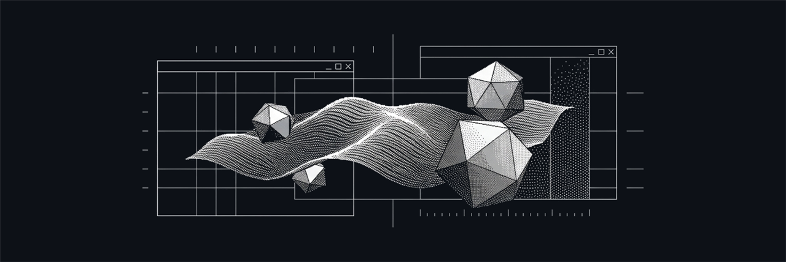

  

<h1 align="center">Olá, eu sou o Thúlio Gabriel 👋</h1>

  

  Estudante de Análise e Desenvolvimento de Sistemas em Pernambuco, Brasil · Focado em aplicações web modernas, APIs seguras e automação com dados.

---

<h2 align="center">🚀 Sobre mim</h2>

Sou **Thúlio Gabriel** (`thuling`), desenvolvedor de **Pernambuco, Brasil**, graduando em **Análise e Desenvolvimento de Sistemas (ADS)**.

Desenvolvo aplicações **Full Stack e Back-End** orientadas à resolução de problemas reais — de plataformas web e sistemas multi-tenant a APIs REST, automações e processamento geoespacial.

- 🛠️ **Stack principal:** **TypeScript**, **Next.js / React**, **Node.js (Express)**, **Python (FastAPI)** e **Java**.
- 🗄️ **Dados & Infra:** **PostgreSQL**, **MySQL**, **Prisma ORM**, **Redis**, **Docker** e **Nginx**.
- 🎯 **Foco atual:** Arquitetura limpa, segurança de aplicações (autenticação, RBAC, 2FA) e código sustentável em produção.

 

---

<h2 align="center">🤝 Contato</h2>

  
  
  
  

---

<h2 align="center">💻 Stack Tecnológica</h2>

  

---

<h2 align="center">📌 Projetos em Destaque</h2>

| Projeto | Descrição | Tecnologias |
| :--- | :--- | :--- |
| [**farol-financas-next**](https://github.com/thuling/farol-financas-next) | Plataforma de finanças pessoais com autenticação 2FA por e-mail, importação CSV/OFX e integração Open Finance | `Next.js 15` `React 19` `TypeScript` `Prisma` `PostgreSQL` |
| [**mapa-verde**](https://github.com/thuling/mapa-verde) | Analisador e mapeador geoespacial de áreas verdes urbanas com geração de mapas interativos e GeoPackages | `Python` `OSMnx` `GeoPandas` `Folium` |
| [**desafio-back-end-valcann**](https://github.com/thuling/desafio-back-end-valcann) | Modelagem de banco de dados relacional e API REST com paginação e filtros | `Python` `FastAPI` `SQL` |
| [**SystemXadrezJAVA**](https://github.com/thuling/SystemXadrezJAVA) | Sistema completo de xadrez aplicando Programação Orientada a Objetos e regras completas do jogo | `Java` `POO` |

---

<h2 align="center">📊 Estatísticas no GitHub</h2>

  
  

  

  

